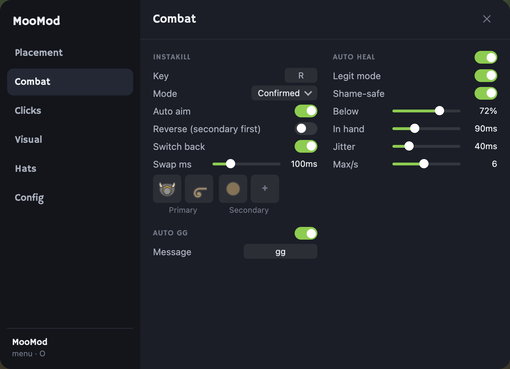
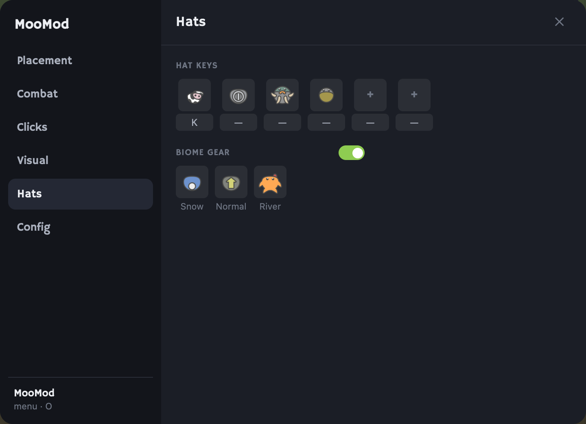
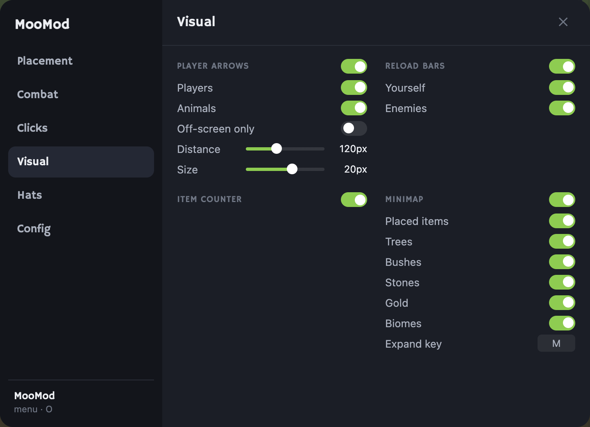
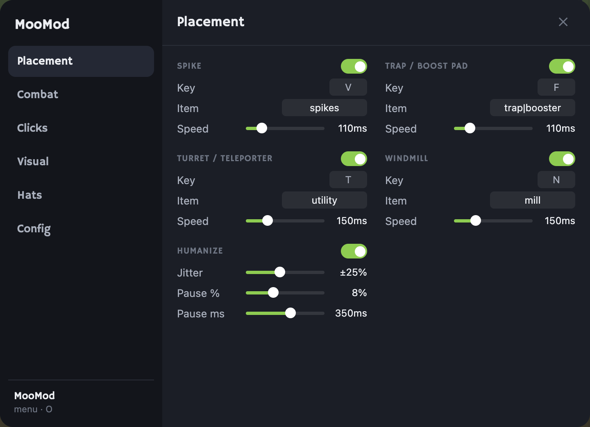
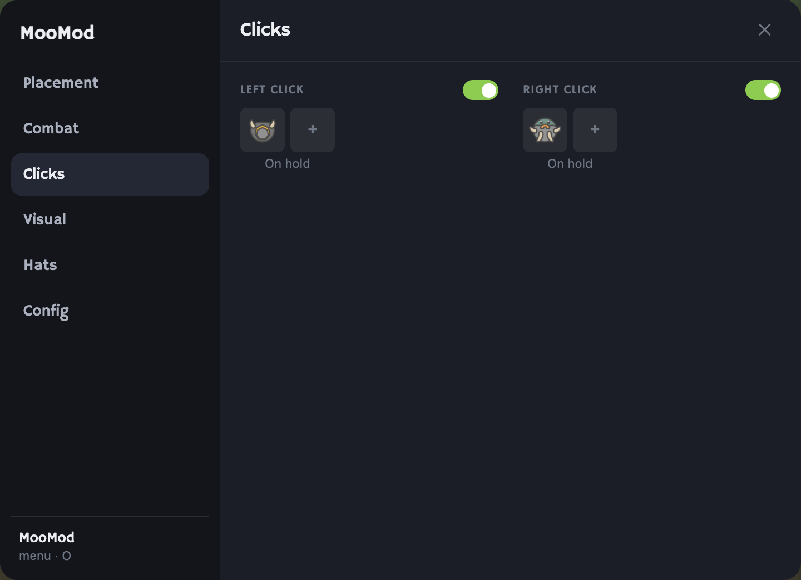
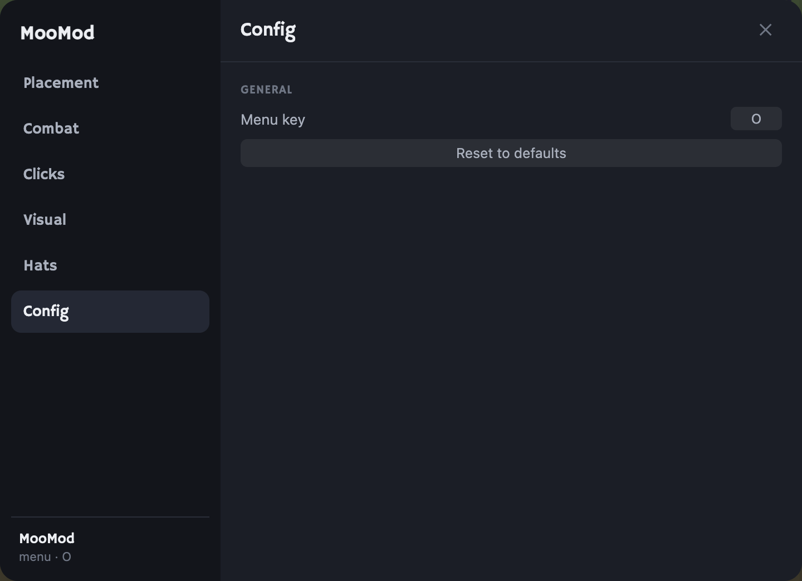
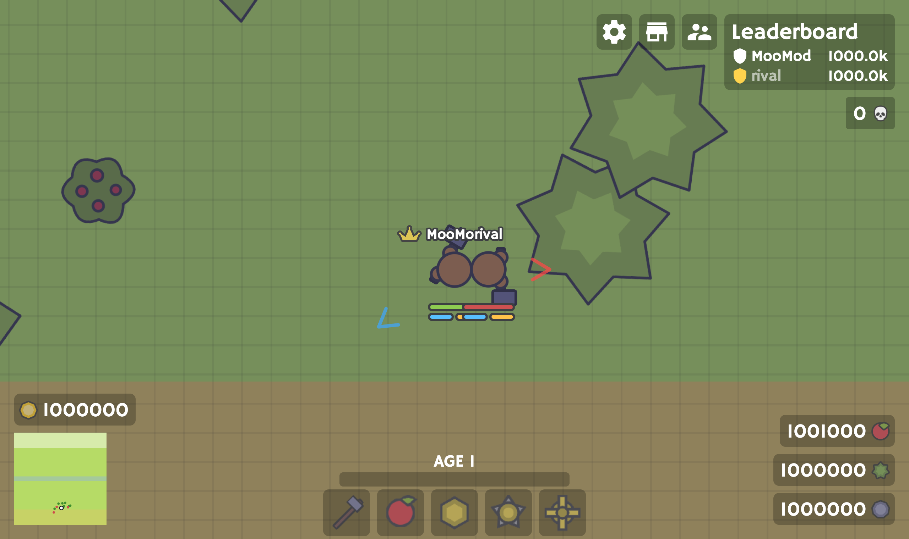
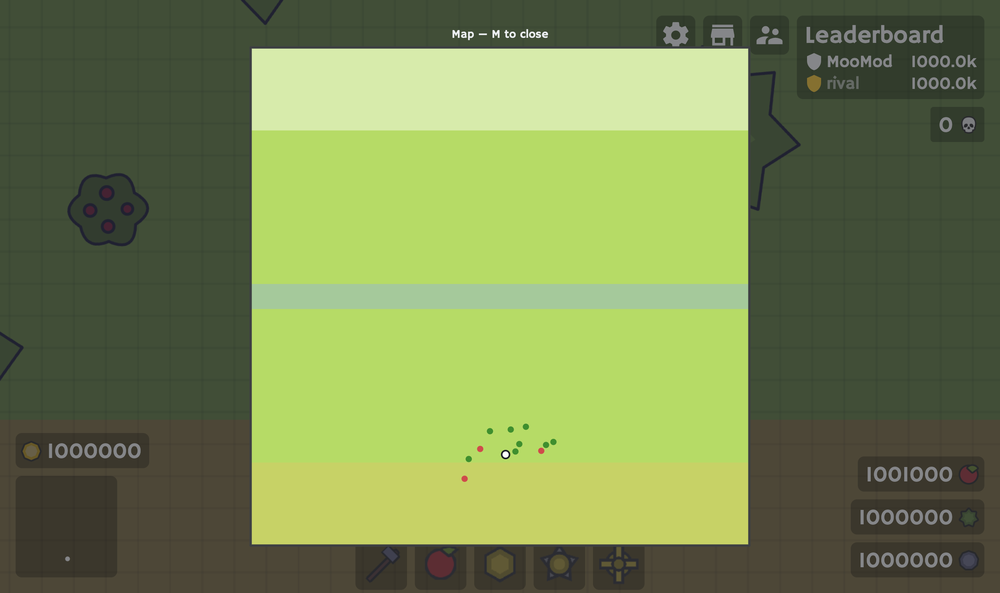

# MooMod

A clean, all-in-one mod for [MooMoo.io](https://moomoo.io) — instakill, biome auto‑gear, auto heal, place spammers, click‑hats, on‑screen arrows, reload bars and a minimap, all in one simple menu. Built on an undetectable loader that sanitises the game's anti‑cheat telemetry, so the mod leaves no footprint on the wire.

Press **O** in‑game to open the menu.



---

## Features

### Combat
- **Instakill** — one key fires your primary, then your secondary, auto‑aiming at the **closest enemy** (both shots). It swaps a hat + accessory in for each shot and restores your loadout afterwards.
  - **Reverse** mode shoots the secondary first, then the primary.
  - **Confirmed** mode waits for the server to register your swing; **Timed** mode uses a fixed delay.
- **Auto heal** — legit‑looking auto heal with a configurable threshold, jitter and max rate. **Shame‑safe** mode never trips the game's anti‑auto‑heal "Shame!" system.
- **Auto GG** — sends a custom chat message every time you get a kill (with a cooldown so multi‑kills don't spam).

### Hats
- **Biome gear** — automatically swaps your hat to match the biome you walk into: snow → Winter Cap, the river → Flipper, everywhere else → Booster. Each slot is configurable, and it never fights your other hat features.
- **Hat hotkeys** — bind keys to equip/unequip any hat you own.
- **Click‑hats** — hold the left or right mouse button to wear a hat + accessory combo, and revert the moment you let go.

### Placement
- **Spammers** for spikes, traps / boost pads, turrets / teleporters and windmills, each on its own key and speed.
- **Humanize** — adds jitter and the occasional pause so placement looks natural.

### Visual
- **Player arrows** — minimal, see‑through chevrons around you pointing at every player and animal: enemies red, teammates green, animals blue.
- **Reload bars** — two bars under every player (primary + secondary), mirroring the game's **native** per‑weapon reload exactly — projectile‑aware (bows/crossbows move too) and swap‑aware (swapping weapons pauses the bar until you swap back).
- **Item counter** — a running count of each item you've placed, shown on its action‑bar icon.
- **Minimap** — your placed buildings (as their icons) plus resource dots and translucent biome bands over the game's minimap; press **M** for a full‑screen map.

### Undetectable by design
MooMod runs on a loader that hooks the game's WebSocket invisibly and rebuilds the anti‑cheat telemetry packet so it reports only what the original client would — every loader/mod footprint bit is stripped while the "canary" checks a real client always passes are left intact. The loader also **self‑protects**: if the anti‑cheat ships a probe kind it doesn't yet handle, or its sanitiser is ever blinded, the loader detects it and warns instead of silently leaking.

---

## Screenshots

| Combat | Hats (biome gear) | Visual |
|---|---|---|
|  |  |  |

| Placement | Clicks | Config |
|---|---|---|
|  |  |  |

**In action** — chevron arrows, reload bars and the biome minimap:



Press **M** for the full‑screen biome map:



---

## Install

1. Install a userscript manager: [Tampermonkey](https://www.tampermonkey.net/) (Chrome/Edge) or [Violentmonkey](https://violentmonkey.github.io/).
2. Open **[`moomod.user.js`](moomod.user.js)** → click **Raw** → the manager will offer to install it.
3. Open [moomoo.io](https://moomoo.io) and press **O** for the menu.

The userscript `@require`s the loader it needs, so there's nothing else to install — the manager fetches it automatically.

## Usage

- **O** — open / close the menu (rebindable in the menu).
- **R** — instakill. **M** — full‑screen map. **K** and other keys — your hat hotkeys.
- Every toggle, key bind and value lives in the menu and saves automatically.

## Build from source

The installable `moomod.user.js` is generated from `src/moomod.js`. It's plain Node, no dependencies:

```bash
node build.mjs
# or point the loader @require somewhere else:
node build.mjs https://example.com/your-loader.user.js
```

## Project layout

```
MooMod/
├── moomod.user.js   the file you install (userscript header + source)
├── src/moomod.js    the readable mod source
├── build.mjs        wraps src/ into moomod.user.js
├── images/          menu + in-game screenshots
└── README.md
```

## Disclaimer

MooMod is a personal project for learning about game clients, WebSocket protocols and browser userscripts. Using mods may violate a game's terms of service — use it on your own account, at your own risk.

## License

[MIT](LICENSE) © al007ex
